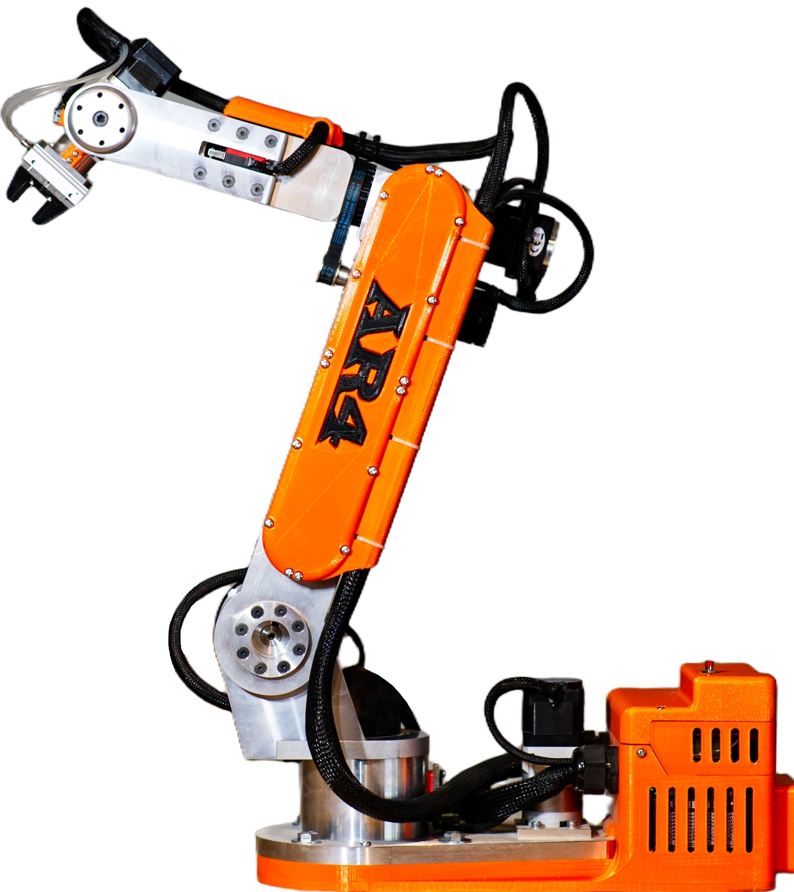
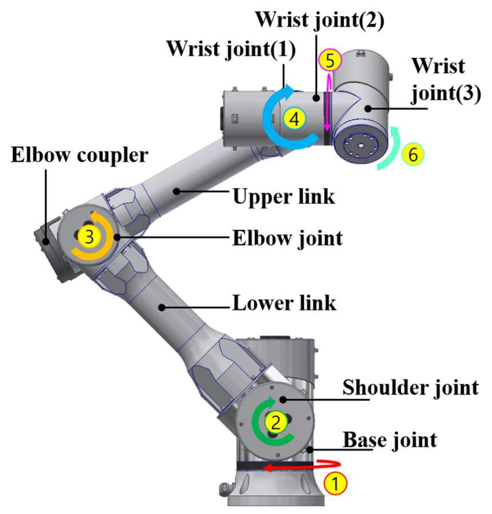

# AR4 Robotic Arm

  

## Project Overview

This project focuses on the development, integration, and control of an AR4 robotic arm, combining mechanical systems, electronics, embedded programming, and robotic software.

The project provides practical experience in robotics, motor control, hardware integration, and ROS-based robot visualization and control.

## Objectives

- Control the different joints of the robotic arm.
- Integrate stepper motors and motor drivers.
- Implement end-stop detection.
- Control the robotic gripper.
- Integrate embedded controllers with the robotic system.
- Integrate the robot with ROS Noetic.
- Visualize the robot using RViz.
- Test and troubleshoot the complete hardware and software system.

  

## Hardware

- AR4 robotic arm
- Teensy 4.1
- Arduino Mega
- DM542A stepper motor drivers
- Stepper motors
- End-stop switches
- Robotic gripper
- Power supply
- Electronic wiring and hardware interfaces

## Software and Tools

- C / C++
- Arduino
- ROS Noetic
- Ubuntu 20.04
- RViz
- URDF / Xacro
- Catkin
- CMake
- Git

## Robotics

The project involves the following robotics concepts:

- Robot geometry
- Forward kinematics
- Inverse kinematics
- Joint control
- Motion control
- Gripper control
- Robot visualization
- Hardware and software integration
 

  

## Electronics and Embedded Systems

The system integrates:

- Microcontrollers
- Stepper motors and motor drivers
- End-stop sensors
- STEP/DIR control signals
- Digital input/output
- Embedded controllers
- Hardware wiring and troubleshooting

## Testing and Troubleshooting

The development process follows an iterative engineering approach:

**Understand → Diagnose → Test → Fix → Validate → Improve**

Hardware and software components are tested progressively to identify configuration, wiring, and control issues and improve the reliability of the robotic system.

## Project Images

Additional photographs, mechanical diagrams, and technical documentation can be added as the project develops.

## Author

**Skandar Makari**

Electronics, Embedded Systems, Robotics, and Mechatronics

Dijon, France
